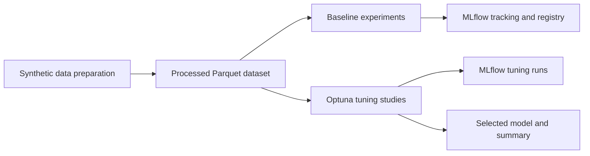

# From Model Training to MLOps: An Airflow, MLflow, and Optuna Project

*A practical portfolio project for orchestrating regression experiments, tracking models, and tuning hyperparameters.*

> **Before publishing:** Replace the bracketed prompts with screenshots and
> metric values from your own successful runs. Do not present the synthetic
> dataset or its scores as real housing-market research.

## The gap between a model and a repeatable workflow

Training a model in a notebook is a useful start. But a repeatable machine
learning workflow also needs to answer a few operational questions: Where did
the data come from? Which parameters and metrics produced this model? Can I
compare experiments later? Can I rerun the workflow and identify the model I
selected?

I built this project to explore those questions with a small, reproducible
regression pipeline. Apache Airflow coordinates the tasks, MLflow records
experiments and model artifacts, and Optuna searches model hyperparameters.
The goal is to demonstrate the workflow, not to claim a production-ready
housing-price model.

**Project repository:** [add your GitHub repository URL]

## What the project does

The workflow starts with a deterministic generator that creates 2,000
synthetic housing records. It adds a few missing garage values so the
preparation step can demonstrate median imputation, then writes a processed
Parquet dataset for both DAGs to use. The synthetic target is generated from a
known formula with noise; it is not collected from actual property sales.

The model features include area, bedrooms, bathrooms, house age, distance,
garage spaces, a bedroom-to-bathroom ratio, and a new-house indicator. I
exclude `price_per_sqft`, even though it is easy to calculate, because it is
derived directly from the target price. Using a target-derived input would
leak information into training and make evaluation misleading.

## A small Airflow architecture

The repository contains two independently runnable DAGs:

- **MLflow tracking:** trains Ridge Regression, Random Forest, and Gradient
  Boosting on the same train/test split. Each run logs parameters, cross-
  validation and test metrics, and a model artifact to MLflow. Random Forest
  feature importance is saved as an artifact. The model with the best
  cross-validation R² is selected and its registered version is transitioned
  to `Staging`.
- **Hyperparameter tuning:** runs separate Optuna studies for Random Forest
  and Gradient Boosting. Each study uses a seeded TPE sampler, three-fold
  cross-validation, and a median pruner that can stop weak trials between
  folds. The best candidate is refit and scored on the held-out test split.

Airflow's TaskFlow API makes model runs separate tasks, allowing the baseline
experiments and the two tuning studies to run independently. A final task
compares the tuning results using cross-validation R² and saves the selected
estimator and a JSON summary.

**Suggested image:** Add a screenshot of the Airflow DAG graph after a
successful run.

## Why keep the test set separate?

Hyperparameter search repeatedly compares candidates. If the held-out test
set influences those choices, it stops being a fair final check. In this
project, Optuna optimizes mean R² across three folds of the training data. The
test split is used after selection to report a final score, not to choose
parameters or the winner.

The scores are still only an illustration: because the dataset is synthetic
and generated from a simple formula, good results do not imply that these
models will perform well on real property data. A real application would need
versioned source data, stronger validation, and an evaluation strategy that
matches how predictions will be used.

## Running the project

The setup guide in the repository README covers the Python 3.11 environment,
Airflow constraints, and local MLflow server. At a high level, the workflow is:

1. Install the pinned requirements in the isolated project environment.
2. Generate the dataset with `python scripts/prepare_data.py`.
3. Start the local MLflow tracking server.
4. Configure Airflow to use this repository's `dags` folder.
5. Run `tutorial_mlflow_tracking` and
   `tutorial_hyperparameter_tuning` with the Airflow CLI.

The tuning DAG defaults to 30 trials per model. For a quick smoke run, set
`OPTUNA_TRIALS=2`; use more trials when you have time and compute available.
The local MLflow UI makes it possible to inspect run parameters, metrics,
artifacts, and registered model versions.

**Suggested image:** Add a screenshot of both MLflow experiments with their
run metrics visible. Blur or remove any local paths or personal information.

## What I learned

This project made a few practical MLOps details more concrete for me:

- A DAG is more useful when data paths and configuration are reproducible,
  rather than tied to one machine.
- Tracking parameters, metrics, and model artifacts together makes experiment
  comparisons easier to audit.
- Cross-validation is appropriate for model selection; a held-out test set
  should remain separate for final evaluation.
- Pruning is most useful when the objective reports intermediate progress.
- Data leakage can enter through feature engineering, not just through an
  obviously incorrect train/test split.
- A model registry state such as `Staging` is a workflow signal, not proof
  that a model is ready for production.

## Results

Insert the actual output from your MLflow runs here. For example:

| Model | Cross-validation R² | Test R² | Notes |
| --- | ---: | ---: | --- |
| Ridge Regression | [value] | [value] | Baseline |
| Random Forest | [value] | [value] | Baseline or tuned |
| Gradient Boosting | [value] | [value] | Baseline or tuned |

Use the values recorded by your run, state whether each row is a baseline or
tuned model, and avoid comparing numbers produced from different splits.

## Limitations and next steps

This is a local learning project. It uses synthetic data, a local tracking
server, and pickle-based model artifacts. It does not include production
authentication, remote artifact storage, a serving API, or a deployment
approval process. Pickle-based artifacts should only be loaded from trusted
sources.

Possible next steps include replacing the generator with a versioned public
dataset, adding data-quality checks, testing the DAGs in CI, and defining a
deployment process with explicit model validation gates.

## Closing

The most useful outcome was not a single score. It was connecting data
preparation, orchestration, experiment tracking, model selection, and artifact
management into one workflow that can be rerun and inspected. That is the
foundation I wanted to practice before applying these patterns to a real
dataset.

---

*This article describes a portfolio learning project. Its data and results
are synthetic and should not be used for financial or real-estate decisions.*