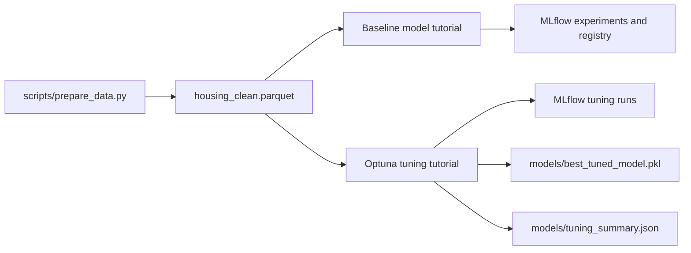

# Housing Model Tracking and Tuning

A reproducible MLOps portfolio project that orchestrates regression experiments
with Apache Airflow, tracks model runs with MLflow, and searches model
hyperparameters with Optuna. It includes a deterministic synthetic-data
generator, two runnable DAGs, local experiment tracking, and saved model
artifacts.

> The housing records are synthetic and generated for demonstration. They are
> not real estate data and should not be used to make financial or property
> decisions.

## Project Highlights

- Airflow TaskFlow DAGs with parallel model-training tasks and explicit result
  selection.
- MLflow parameter, metric, model, and feature-importance artifact logging.
- MLflow Model Registry versioning and promotion of the selected baseline to
  `Staging`.
- Optuna TPE search with cross-validation and median pruning between folds.
- Deterministic synthetic data generation (`seed=42`) and leak-free model
  features. The target-derived `price_per_sqft` feature is intentionally
  excluded.
- Portable paths derived from the repository location, with optional tracking
  and trial-count environment settings.

## Architecture



## Repository Layout

```text
.
├── dags/
│   ├── tutorial_mlflow_tracking.py
│   └── tutorial_hyperparameter_tuning.py
├── data/
│   ├── raw/
│   └── processed/
├── models/
├── scripts/
│   └── prepare_data.py
├── tests/
│   └── test_prepare_data.py
├── .gitignore
├── README.md
└── requirements.txt
```

Generated datasets, Airflow state, MLflow databases/artifacts, logs, and model
pickles are ignored by Git. They are produced locally when the project runs.

## Requirements

- Linux or macOS, or Windows through WSL2
- Python 3.11
- Apache Airflow 2.9.3
- The pinned packages in `requirements.txt`

Airflow must be installed with the matching official constraints file. Keeping
Airflow's dependency constraints in the same pip operation prevents its
dependencies from being replaced by incompatible versions.

## Installation

Run the following from the repository root in a Linux, macOS, or WSL terminal:

```bash
cd /mnt/e/ML-OPS/MLWOKS/mlops-airflow/mlops-airflow/airflow-mlflow-optuna-project
curl -LsSf https://astral.sh/uv/install.sh | sh
source "$HOME/.local/bin/env"
uv python install 3.11
uv venv --python 3.11 --seed .venv
source .venv/bin/activate
.venv/bin/python -m pip install --upgrade pip

AIRFLOW_VERSION=2.9.3
PYTHON_VERSION=3.11
CONSTRAINT_URL="https://raw.githubusercontent.com/apache/airflow/constraints-${AIRFLOW_VERSION}/constraints-${PYTHON_VERSION}.txt"
.venv/bin/python -m pip install -r requirements.txt --constraint "${CONSTRAINT_URL}"
```

This installs Python 3.11 under `uv`'s managed Python directory, so it does not
depend on Ubuntu's system Python packages. If `uv` is already installed, skip
the installer command and run the remaining commands. Do not create this
environment with the system's Python 3.14.

Set Airflow's local state directory and DAG folder in each terminal that runs
Airflow commands:

```bash
export AIRFLOW_HOME="$PWD/.airflow"
export AIRFLOW__CORE__DAGS_FOLDER="$PWD/dags"
export AIRFLOW__CORE__LOAD_EXAMPLES=False
```

On Windows, use WSL2 and run these commands from the project's mounted folder;
the Airflow and MLflow processes should both run inside that same WSL
environment.

## Prepare Data

Generate 2,000 deterministic rows, including a small number of missing garage
values that the preparation step imputes:

```bash
python3 scripts/prepare_data.py
```

This creates `data/raw/housing_raw.csv`, raw-data metadata, and
`data/processed/housing_clean.parquet`. Both DAGs read the processed Parquet
file. Re-running the script with the default seed reproduces the same feature
and target values.

Run the data-preparation tests after installing dependencies:

```bash
python -m unittest discover -s tests
```

## Start MLflow

In a second terminal, activate the same virtual environment, change to the
repository root, and start a local tracking server:

```bash
cd /mnt/e/ML-OPS/MLWOKS/mlops-airflow/mlops-airflow/airflow-mlflow-optuna-project
source .venv/bin/activate
export MLFLOW_TRACKING_URI="http://127.0.0.1:5000"
mlflow server \
  --backend-store-uri "sqlite:///$PWD/mlflow.db" \
  --default-artifact-root "$PWD/mlartifacts" \
  --host 127.0.0.1 \
  --port 5000
```

Open the MLflow UI at <http://127.0.0.1:5000>. The server binds to loopback;
keep this local learning service off public network interfaces.

## Run the DAGs

Initialize and start Airflow in another terminal. Then use an additional
terminal with the same Airflow variables for each DAG test:

```bash
source .venv/bin/activate
export AIRFLOW_HOME="$PWD/.airflow"
export AIRFLOW__CORE__DAGS_FOLDER="$PWD/dags"
export AIRFLOW__CORE__LOAD_EXAMPLES=False
export MLFLOW_TRACKING_URI="http://127.0.0.1:5000"

airflow db migrate
airflow dags list-import-errors
airflow dags test tutorial_mlflow_tracking 2024-01-01
airflow dags test tutorial_hyperparameter_tuning 2024-01-01
```

For an interactive local Airflow UI, use a separate terminal with the same
environment variables and run:

```bash
airflow standalone
```

Airflow prints the local UI address and generated login details. The test
commands execute a DAG directly and do not require the scheduler to be running.

### Quick tuning run

The tuning DAG defaults to 30 trials per model. For a faster smoke run, lower the
trial count in the terminal that launches the DAG test:

```bash
export OPTUNA_TRIALS=2
airflow dags test tutorial_hyperparameter_tuning 2024-01-01
```

Increase the value for a deeper search. Trial count is configurable; the
search-space ranges remain defined in the DAG.

## What the DAGs Produce

### Tutorial: MLflow Tracking

Runs Ridge Regression, Random Forest, and Gradient Boosting against the same
80/20 split. It logs parameters, MAE, RMSE, R², and model artifacts to the
`housing_price_prediction` MLflow experiment. Each model is registered as
`HousingPricePredictor`; the highest cross-validation-R² run's registry version
is moved to `Staging`. Random Forest feature importance is logged to MLflow and written to
`models/feature_importance.json`.

### Tutorial: Hyperparameter Tuning

Tunes Random Forest and Gradient Boosting independently using seeded Optuna
TPE studies. Three-fold cross-validation reports intermediate fold scores so
the median pruner can stop unpromising trials. The selected estimators are
refit on the training split and evaluated on the held-out test split. The DAG
logs the best parameters, CV R², test R², trial count, and model artifacts to
the `housing_hyperparameter_tuning` experiment.

Local outputs include `models/rf_tuned.pkl`, `models/gb_tuned.pkl`,
`models/best_tuned_model.pkl`, and `models/tuning_summary.json`. The summary
records the winner and runner-up based on cross-validation R², alongside their
held-out test scores.

## Reproducibility and Evaluation Notes

- Data generation and train/test splitting use fixed random seeds.
- Optuna uses a seeded TPE sampler; estimator random states are fixed.
- Validation R² is used as the tuning objective; test R² is reported only after
  the best parameters have been selected.
- Both DAGs select their winner using cross-validation R² computed from the
  training split. The held-out test split is reserved for final reporting.
- The small synthetic dataset is designed for quick demonstrations. Results
  illustrate the workflow, not production model quality or generalization.
- Model files use Python pickle-based serialization. Only load artifacts from
  sources you trust.

## Troubleshooting

- **Missing `housing_clean.parquet`:** activate the environment and run
  `python scripts/prepare_data.py` from the repository root.
- **`externally-managed-environment` from pip:** pip is using system Python.
  Create the project environment with `uv venv --python 3.11 --seed .venv311`,
  then install through `.venv311/bin/python -m pip` as shown above. Do not use
  `--break-system-packages`.
- **`ModuleNotFoundError: No module named 'pkg_resources'`:** in the active
  project environment, install a compatible setuptools release with
  `python -m pip install 'setuptools<81'`, then verify it with
  `python -c 'import pkg_resources; print(pkg_resources.__file__)'`. This
  commonly occurs when setuptools 81 or newer was installed. Afterward, run
  `airflow dags list-import-errors`; the DAG lookup error may have been caused
  by the earlier Airflow startup failure.
- **DAG missing or import errors:** check that `AIRFLOW__CORE__DAGS_FOLDER`
  points to this repository's `dags/` directory and run
  `airflow dags list-import-errors`.
- **MLflow connection refused:** start the MLflow server first and confirm that
  `MLFLOW_TRACKING_URI` is the same in the server and Airflow terminal.
- **Slow tuning:** set `OPTUNA_TRIALS=2` to smoke-test the DAG, then raise it
  for a larger search.

## Future Improvements

- Replace synthetic data with a versioned real-world dataset and add data
  validation gates.
- Add time-based or nested validation where the data and evaluation goal call
  for it.
- Add CI for DAG import checks, formatting, and unit tests.
- Configure an authenticated remote artifact store and explicit deployment
  promotion policy for production use.